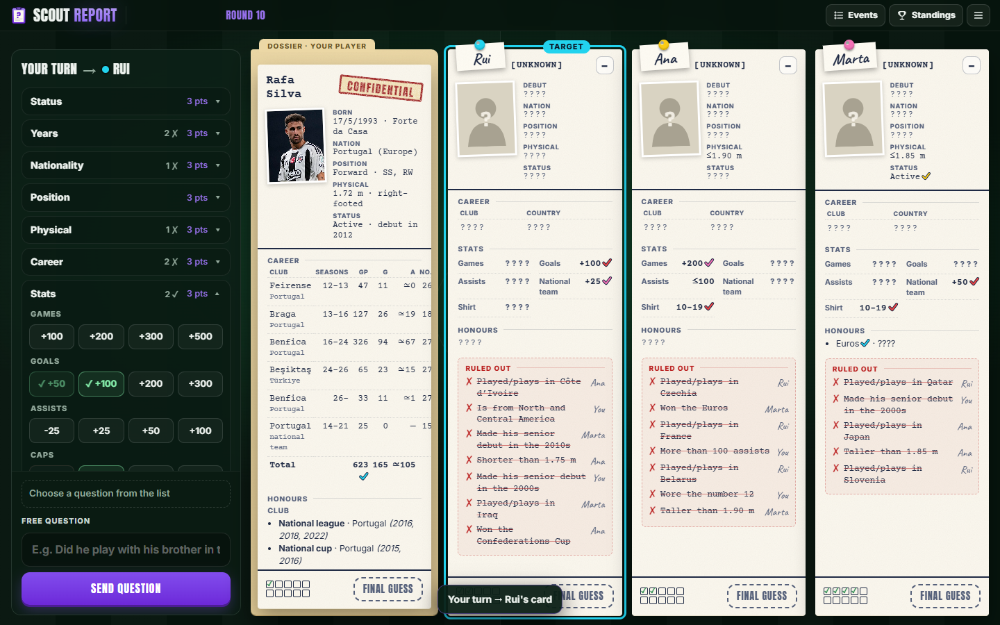
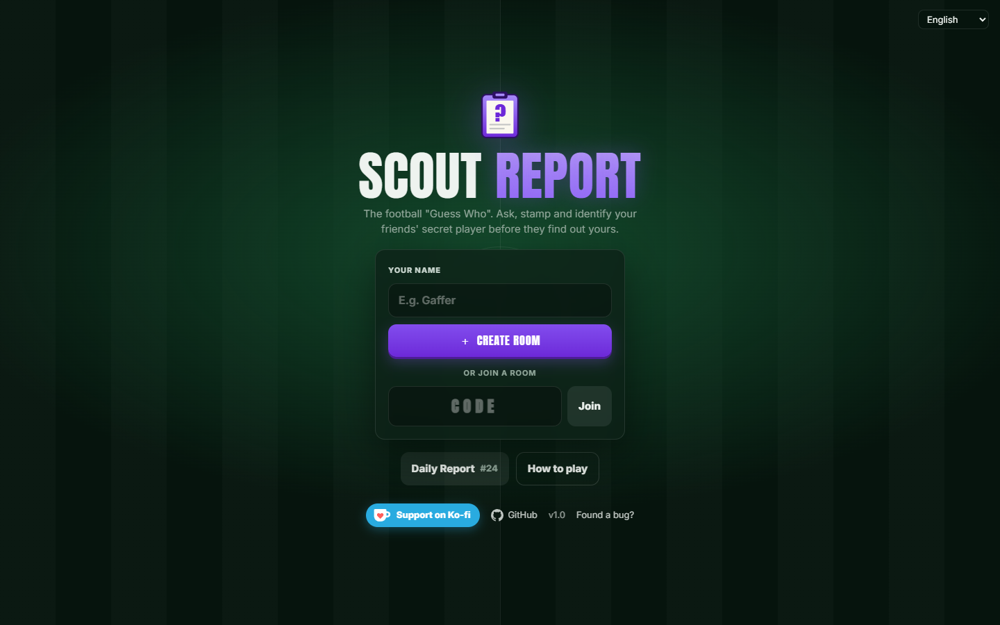
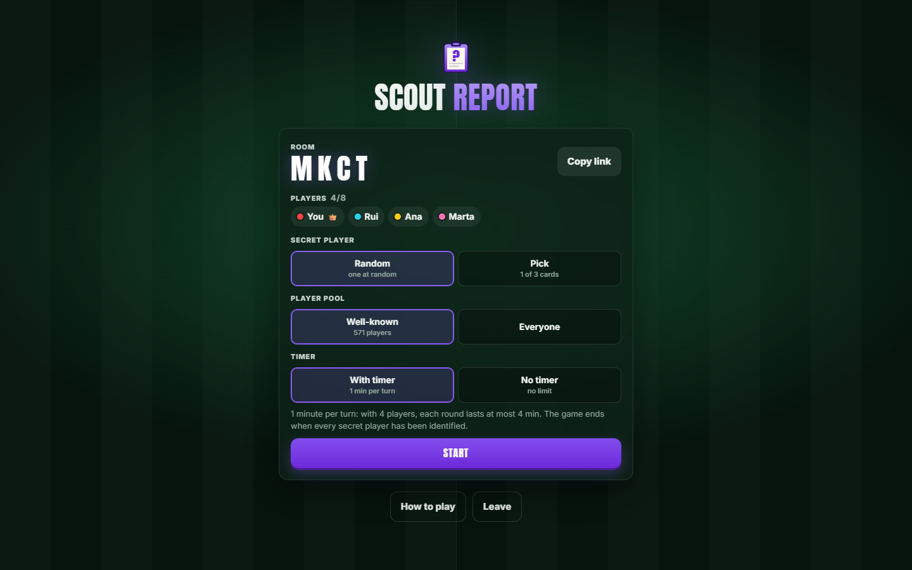
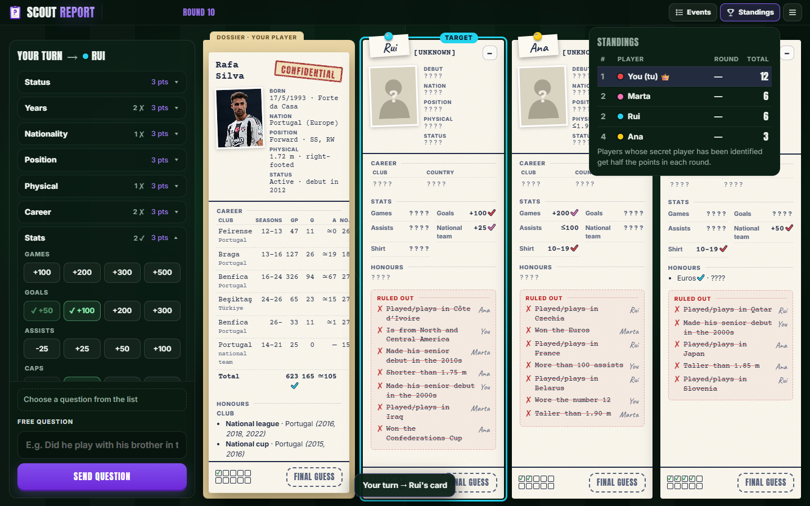
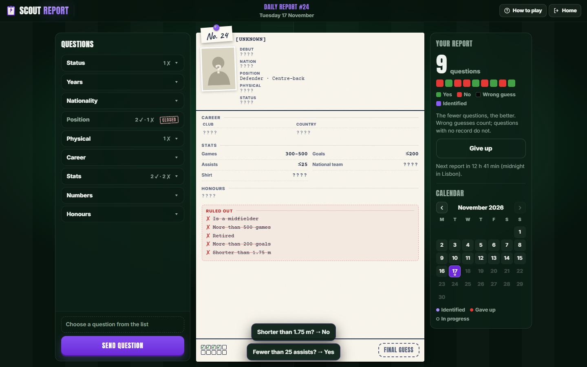
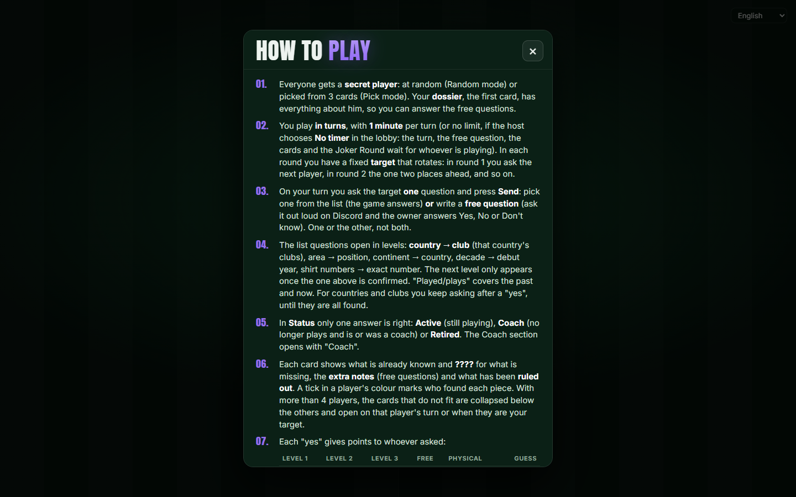
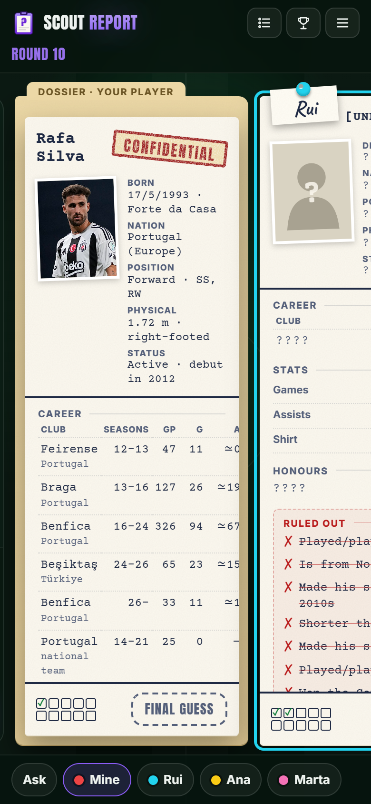
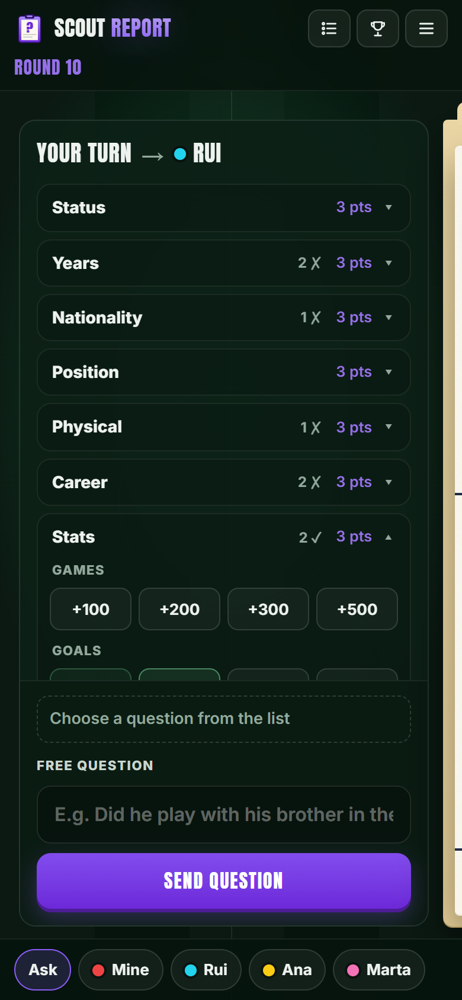

<div align="center">


# Scout Report

**The football "Guess Who": ask, stamp and identify your friends' secret player before they find out yours.**<br>
Real-time multiplayer on Discord-sized rooms, with scouting-report cards, a Joker Round and a Daily Report. Free to host on Cloudflare.

<a href="https://scout-report.bacoinz.workers.dev"></a>  <a href="LICENSE.md"></a>    <a href="https://ko-fi.com/bacoinz"></a>

[**▶ Play now**](https://scout-report.bacoinz.workers.dev) · [Daily Report](https://scout-report.bacoinz.workers.dev/dia?lang=en) · [How to play](#how-to-play) · [Run your own](#run-your-own) · [Report a bug](https://github.com/bacoinz/scout-report/issues/new/choose) · [🇵🇹 Português](README.pt-PT.md)



</div>

> [!TIP]
> **Try it right now:** open **[scout-report.bacoinz.workers.dev](https://scout-report.bacoinz.workers.dev)**, create a room and share the link with your friends (Discord works great). No account, no install. Alone? The **[Daily Report](https://scout-report.bacoinz.workers.dev/dia?lang=en)** is a mystery player a day, the same for everyone.

## Why Scout Report

Football quizzes are usually solo and about one clue at a time. "Guess Who" is great with friends, but a football edition with real players needs hundreds of faces and a way to answer questions fairly.

Scout Report is both. Everyone gets a secret player; on your turn you ask a question about someone else's, and the game answers it for you from real career data. Every answer is stamped on a scouting-report card, so the table slowly fills in. First to work out who it is wins the points.

## Features

**The game**

- **A secret player for everyone:** at random, or picked from 3 cards. About 880 players born from 1960, from Ballon d'Or top 30s, national teams, big clubs, finalists of World Cups, Euros and Champions Leagues, and a hand-picked list of legends.
- **Structured questions the game answers by itself:** 3 levels that unlock one after the other (continent → country, country → club, decade → debut year…). Career, position, physical, status, stats, shirt numbers, honours and a Coach section.
- **Free questions:** ask anything out loud on Discord and the card's owner answers Yes, No or Don't know.
- **A scouting-report card for each player:** every confirmed fact is stamped, ruled-out information is struck through, and a **tick in the colour of the player who found it** shows who found what. Your own **dossier** shows everything about your player (and what the others have found).
- **Final guess** once a card has 10 "yes" and a confirmed club. Typos and nicknames count.
- **Joker Round:** once per game, a number question about the least-known card (games, goals, debut year…). Everyone guesses in secret; closest without going over wins.
- **No round limit:** the game ends when every secret player is identified. With or without a 1-minute timer, chosen in the lobby.
- **Daily Report:** one mystery player a day, the same for everyone, played solo. Your score is the number of questions; copy the 🟩🟥🟪 result to share it. A calendar lets you play the days you missed.

**Everything else**

- **2 to 8 players** in real time, with reconnection, spectators joining mid-game and a host that moves on if they leave.
- **English and Portuguese**, switchable on the start screen and in the game menu.
- **No AI anywhere:** all answers come from structured data, checked in code.
- **Works on phones:** the cards become swipeable pages.

## Screenshots

<table>
  <tr>
    <td width="50%"></td>
    <td width="50%"></td>
  </tr>
  <tr>
    <td></td>
    <td></td>
  </tr>
  <tr>
    <td></td>
    <td align="center"> </td>
  </tr>
</table>

## How to play

1. **Create a room** at [scout-report.bacoinz.workers.dev](https://scout-report.bacoinz.workers.dev) and share the link. In the lobby the host picks how secret players are given out (random or pick 1 of 3 cards), the player pool (well-known or everyone) and with or without a timer.
2. **Everyone gets a secret player.** Your **dossier**, the first card, has everything about yours, so you can answer the free questions without looking anything up. Looking up the others' players is not allowed.
3. **On your turn** you ask your **target** (it rotates every round) one question: pick one from the list (the game answers) *or* write a free question and ask it out loud. Each "yes" earns points: 3, 6 or 9 by level, 3 for a free question.
4. **The list unlocks in levels:** country → club, area → position, continent → country, decade → debut year. After a "yes" you keep asking for more countries and clubs until they are all found. Not enough data to answer? The card gets a **No record** stamp, and you keep your turn.
5. **The final guess** lights up on a card with 10 "yes" and one confirmed club. On your turn, say who it is: a right guess is worth 30 points and the card is **identified**. Its owner keeps playing, on half points.
6. **The Joker Round** drops in once per game, between round 14 and 17.
7. **The game ends** when every secret player has been identified. Most points wins.

The full rules are in the in-game **How to play** menu.

## Run your own

You need Node 22+, Python 3.12 (to build the player data) and a free Cloudflare account.

```bash
git clone https://github.com/bacoinz/scout-report && cd scout-report/jogo
npm install
```

**1. Get the player data.** The game does not work without its player database (see [Data](#data)), and it is not in the source tree. Download **[scout-report-players-v1.0.zip](https://github.com/bacoinz/scout-report/releases/latest)** from the Releases page (1.3 MB, 878 players) and unzip it inside `pipeline/dados/`, so you end up with `pipeline/dados/jogadores/`. Then turn it into the game's database:

```bash
cd ../pipeline
py -3.12 -m venv .venv
.venv/Scripts/python -m pip install -r requirements.txt     # on macOS/Linux: .venv/bin/python
.venv/Scripts/python -m scout validar
.venv/Scripts/python -m scout exportar                      # SQL for the game's database → pipeline/saida/d1/
```

*Optional:* instead of downloading it, you can rebuild the data from the sources. It takes about 7 hours the first time (it fetches ~12,000 pages politely, one at a time) and resumes if you stop it:

```bash
.venv/Scripts/python -m scout tm descarregar                # transfermarkt-datasets (CC0, ~180 MB)
.venv/Scripts/python -m scout tm preparar
.venv/Scripts/python -m scout paises
.venv/Scripts/python -m scout sementes                      # who is in the pool
.venv/Scripts/python -m scout recolher --candidatos         # the long one
.venv/Scripts/python -m scout validar
.venv/Scripts/python -m scout exportar                      # SQL for the game's database → pipeline/saida/d1/
```

**2. Play locally** (from `jogo/`):

```bash
npm run db:local     # creates the local D1 and loads the players
npm run dev          # http://127.0.0.1:8787
```

Open it in two browser windows to play against yourself, or run `node scripts/e2e.mjs --bots ABCD 3` (with your room code) to add bots.

**3. Put it online:**

1. Log in to Cloudflare: `npx wrangler login`.
2. Create your database: `npx wrangler d1 create scout-report`, then put the `database_id` it prints in `jogo/wrangler.jsonc`. Optionally change `"name"` (it becomes your address) and `DIA_LANCAMENTO`, the date of Daily Report #1.
3. Load it and deploy: `npm run db:remoto && npm run deploy`.

Share the address with your friends. The first deploy creates the Durable Object that stores the rooms.

**The Daily Report calendar** is in the repository (`pipeline/dados/calendario.json`), so it lists every day's mystery player: delete the file before exporting if you want your own surprise. **Keeping it going:** every `exportar` fills the calendar up to 60 days ahead; run `exportar` and `npm run db:remoto` at least once a month (`python -m scout estado` warns you). Without a calendar row the game falls back to a fixed order, so the challenge never goes empty.

## Data

The game needs a database of players with their careers, stats and honours. It is built from public sources and published as an **optional download, but a crucial one**: without it the game has no players. Get `scout-report-players-v1.0.zip` from the [Releases page](https://github.com/bacoinz/scout-report/releases/latest), or rebuild it with the pipeline. It is kept out of the source tree and offered for personal, non-commercial use; the sources have their own terms:

- **Wikipedia** (infoboxes, honours, season squads) and **Wikidata** (ids, birth, nationality, photos, club leagues).
- **zerozero.pt** (games, goals and assists per season, all competitions), fetched at 1 request every 2–3 s, respecting `robots.txt`.
- **transfermarkt-datasets** (foot, height, positions, leagues and numbers from 2012), CC0.

Photos are on Wikimedia Commons, with author and licence shown on hover. The pipeline never uses an LLM: everything is read from structured sources and checked in code (`python -m pytest` in `pipeline/`).

## What it costs

Nothing, on Cloudflare's free plans. Each room is one Durable Object (SQLite storage) whose WebSockets hibernate while nobody plays; the player database is a small D1 database read a few times per game.

## How it works

| Part | What it uses |
|---|---|
| Server | **Cloudflare Workers** + one **Durable Object** per room |
| Players | **D1** (SQLite), loaded from the pipeline |
| Game rules | Plain JavaScript, pure functions shared by the server, the browser and the tests |
| Interface | Plain HTML, CSS and JavaScript modules, no framework |
| Data pipeline | **Python** (`requests`, `mwparserfromhell`, `selectolax`) |

- **The server is authoritative:** the browser only sends intentions, and a player's secret never leaves the server before it is revealed (a test plays whole games and checks it).
- **Translations:** the interface is written in Portuguese and [`jogo/public/js/ingles.js`](jogo/public/js/ingles.js) holds the English for every text, including the server's messages; [`idioma.js`](jogo/public/js/idioma.js) swaps them on screen.
- **Tests:** 160 with Vitest (questions, deductions, game flow, no-leak checks, translation) and about 50 with pytest (pipeline).

```
jogo/src/        Worker and Durable Object (the room), game logic
jogo/public/     Interface, shared question code (js/comum), translations
jogo/scripts/    Tests against a running server, screenshots, data export
jogo/test/       Tests (Vitest)
pipeline/        Python pipeline that builds the player database
partilhado/      Rules and lists shared by the game and the pipeline
docs/            Design notes and screenshots
```

Useful commands, inside `jogo/`: `npm run dev`, `npm test`, `npm run e2e`, `npm run deploy`. Pipeline and Daily Report details are in [docs/desenvolvimento.md](docs/desenvolvimento.md) (in Portuguese).

## Found a bug?

This is version **1.0**, and there will be bugs. If you find one, please **[open an issue](https://github.com/bacoinz/scout-report/issues/new/choose)** saying what you did, what happened and, if you can, a screenshot. Ideas and feedback are welcome too.

## Support

Scout Report is free and has no ads. If you enjoyed it, you can buy me a coffee:

<a href="https://ko-fi.com/bacoinz"></a>

## Credits

- Player data: Wikipedia, Wikidata, zerozero.pt and transfermarkt-datasets (see [Data](#data)). Photos: [Wikimedia Commons](https://commons.wikimedia.org).
- Fonts: Anton, Inter, Courier Prime and Caveat (SIL OFL), via Fontsource. Licences in [`jogo/public/LICENCAS.txt`](jogo/public/LICENCAS.txt).
- Scout Report is a fan-made game, not affiliated with any club, league or player.

## License

[PolyForm Noncommercial 1.0.0](LICENSE.md). Free of charge, you can use it, change it and host it for yourself and your friends, a school or a non-profit. Selling it, or selling access to it as a service, is not allowed. For anything commercial, ask the author.
