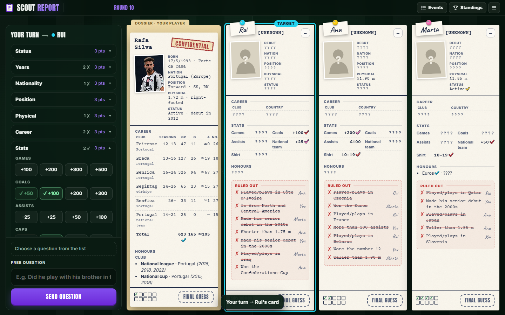
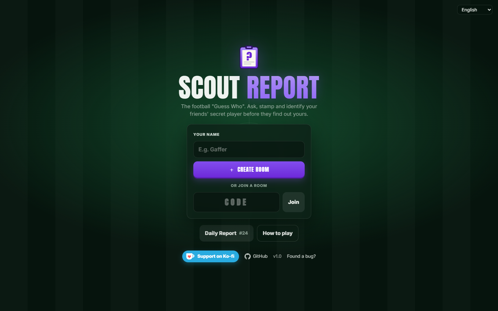
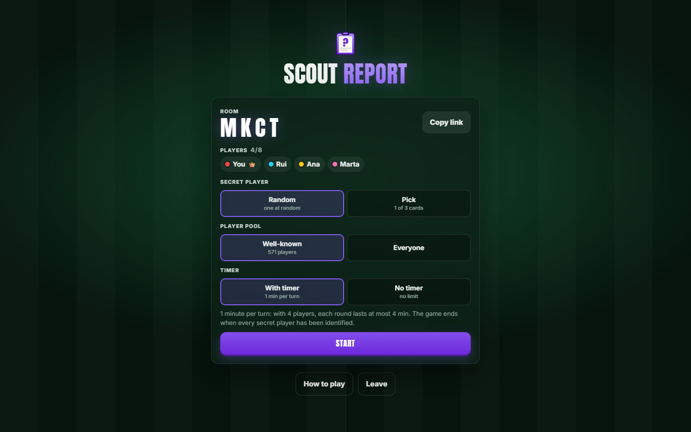
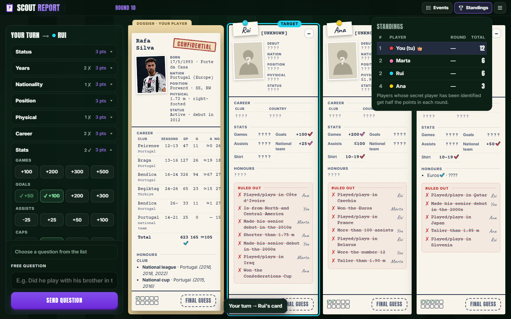
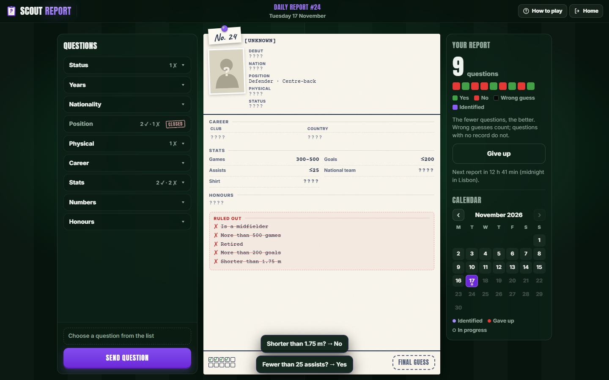
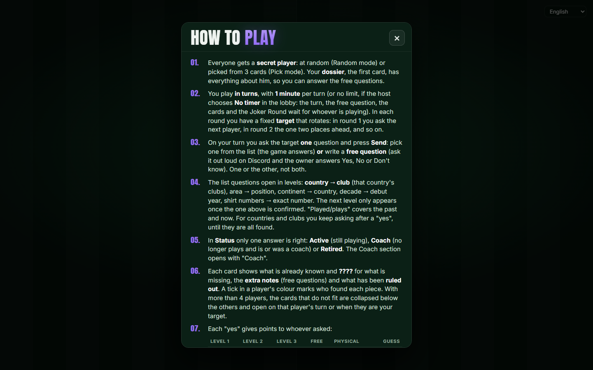
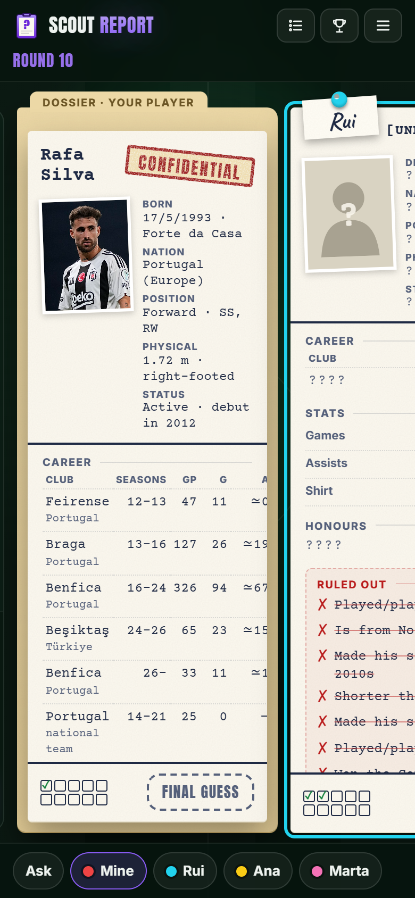
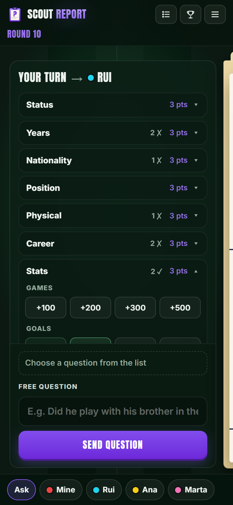

<div align="center">


# Scout Report

**O "Quem é Quem" do futebol: pergunta, carimba e identifica o jogador secreto dos teus amigos antes de eles descobrirem o teu.**<br>
Multijogador em tempo real, com fichas de olheiro, uma Ronda Joker e um Relatório do Dia. Grátis de alojar na Cloudflare.

<a href="https://scout-report.bacoinz.workers.dev"></a>  <a href="LICENSE.md"></a>    <a href="https://ko-fi.com/bacoinz"></a>

[**▶ Jogar agora**](https://scout-report.bacoinz.workers.dev) · [Relatório do Dia](https://scout-report.bacoinz.workers.dev/dia) · [Como jogar](#como-jogar) · [Alojar o teu](#alojar-o-teu) · [Reportar um bug](https://github.com/bacoinz/scout-report/issues/new/choose) · [🇬🇧 English](README.md)



</div>

> [!TIP]
> **Experimenta já:** abre **[scout-report.bacoinz.workers.dev](https://scout-report.bacoinz.workers.dev)**, cria uma sala e partilha o link com os amigos (no Discord funciona muito bem). Sem conta, sem instalar. Sozinho? O **[Relatório do Dia](https://scout-report.bacoinz.workers.dev/dia)** é um jogador mistério por dia, igual para toda a gente.

## Porquê o Scout Report

Os quizzes de futebol costumam ser a solo e de uma pista de cada vez. O "Quem é Quem" é ótimo com amigos, mas uma edição de futebol com jogadores reais precisa de centenas de caras e de uma forma justa de responder às perguntas.

O Scout Report é as duas coisas. Cada um recebe um jogador secreto; na tua vez perguntas sobre o de outro e o jogo responde por ti, a partir de dados reais da carreira. Cada resposta fica carimbada numa ficha de olheiro, e a mesa vai-se enchendo. Quem descobrir primeiro quem é leva os pontos.

## Funcionalidades

**O jogo**

- **Um jogador secreto para cada um:** ao calhas, ou à escolha entre 3 cartas. Cerca de 880 jogadores nascidos desde 1960: top 30 da Bola de Ouro, seleções, grandes clubes, finalistas de Mundiais, Europeus e Ligas dos Campeões, e uma lista de míticos escolhidos à mão.
- **Perguntas estruturadas que o jogo responde sozinho:** 3 níveis que se desbloqueiam um a seguir ao outro (continente → país, país → clube, década → ano de estreia…). Carreira, posição, físico, estado, estatísticas, números, prémios e uma secção de Treinador.
- **Perguntas livres:** pergunta o que quiseres por voz no Discord e o dono da ficha responde Sim, Não ou Não sei.
- **Uma ficha de olheiro por jogador:** cada dado confirmado é carimbado, o que se descartou fica riscado, e um **visto na cor de quem acertou** mostra quem descobriu o quê. O teu **dossier** mostra tudo sobre o teu jogador (e o que os outros já descobriram).
- **Palpite final** quando uma ficha tem 10 "sim" e um clube confirmado. Contam gralhas e alcunhas.
- **Ronda Joker:** uma vez por partida, uma pergunta numérica sobre a ficha menos conhecida (jogos, golos, ano de estreia…). Todos dão palpites em segredo; ganha quem ficar mais perto sem passar.
- **Sem limite de rondas:** a partida acaba quando todos os jogadores secretos forem identificados. Com ou sem timer de 1 minuto, à escolha no lobby.
- **Relatório do Dia:** um jogador mistério por dia, igual para toda a gente, a solo. A pontuação é o número de perguntas; copia o resultado 🟩🟥🟪 para o partilhar. Um calendário deixa-te jogar os dias que perdeste.

**O resto**

- **2 a 8 jogadores** em tempo real, com reconexão, espectadores que entram a meio e um anfitrião que passa para outro se sair.
- **Inglês e português**, no ecrã inicial e no menu do jogo.
- **Sem IA em lado nenhum:** todas as respostas vêm de dados estruturados, verificados em código.
- **Funciona no telemóvel:** as fichas passam a páginas que se deslizam.

## Capturas

<table>
  <tr>
    <td width="50%"></td>
    <td width="50%"></td>
  </tr>
  <tr>
    <td></td>
    <td></td>
  </tr>
  <tr>
    <td></td>
    <td align="center"> </td>
  </tr>
</table>

<sub>Capturas em inglês; o jogo também está em português.</sub>

## Como jogar

1. **Cria uma sala** em [scout-report.bacoinz.workers.dev](https://scout-report.bacoinz.workers.dev) e partilha o link. No lobby, o anfitrião escolhe como se recebe o jogador secreto (ao calhas ou 1 de 3 cartas), a base de jogadores (conhecidos ou todos) e se há timer.
2. **Cada um recebe um jogador secreto.** O teu **dossier**, a primeira ficha, tem tudo sobre o teu, para responderes às perguntas livres sem ires pesquisar. Pesquisar os jogadores dos outros não vale.
3. **Na tua vez** fazes uma pergunta ao teu **alvo** (que muda a cada ronda): uma da lista (o jogo responde) *ou* uma pergunta livre, feita em voz alta. Cada "sim" dá pontos: 3, 6 ou 9 conforme o nível, 3 numa pergunta livre.
4. **A lista desbloqueia-se por níveis:** país → clube, setor → posição, continente → país, década → ano de estreia. Depois de um "sim", continuas a perguntar por mais países e clubes até estarem todos encontrados. Sem dados para responder? A ficha leva o carimbo **Sem registo** e manténs a vez.
5. **O palpite final** acende-se numa ficha com 10 "sim" e um clube confirmado. Na tua vez, dizes quem é: acertar vale 30 pontos e a ficha fica **identificada**. O dono continua a jogar, com metade dos pontos.
6. **A Ronda Joker** aparece uma vez por partida, entre a ronda 14 e a 17.
7. **A partida acaba** quando todos os jogadores secretos forem identificados. Ganha quem tiver mais pontos.

As regras completas estão no menu **Como jogar** do jogo.

## Alojar o teu

Precisas de Node 22+, Python 3.12 (para construir os dados dos jogadores) e uma conta Cloudflare gratuita.

```bash
git clone https://github.com/bacoinz/scout-report && cd scout-report/jogo
npm install
```

**1. Constrói os dados dos jogadores.** A base de jogadores não está neste repositório (ver [Dados](#dados)). Constrói-se uma vez com o pipeline de `pipeline/`, que demora cerca de 7 horas na primeira vez (vai buscar ~12 000 páginas, uma de cada vez) e retoma se o parares:

```bash
cd ../pipeline
py -3.12 -m venv .venv
.venv/Scripts/python -m pip install -r requirements.txt     # em macOS/Linux: .venv/bin/python
.venv/Scripts/python -m scout tm descarregar                # transfermarkt-datasets (CC0, ~180 MB)
.venv/Scripts/python -m scout tm preparar
.venv/Scripts/python -m scout paises
.venv/Scripts/python -m scout sementes                      # quem entra na base
.venv/Scripts/python -m scout recolher --candidatos         # a demorada
.venv/Scripts/python -m scout validar
.venv/Scripts/python -m scout exportar                      # SQL para a base do jogo → pipeline/saida/d1/
```

**2. Joga localmente** (a partir de `jogo/`):

```bash
npm run db:local     # cria o D1 local e carrega os jogadores
npm run dev          # http://127.0.0.1:8787
```

Abre em duas janelas do browser para jogares contra ti, ou corre `node scripts/e2e.mjs --bots ABCD 3` (com o código da tua sala) para juntar bots.

**3. Põe online:**

1. Entra na Cloudflare: `npx wrangler login`.
2. Cria a tua base: `npx wrangler d1 create scout-report` e põe o `database_id` que ele mostra em `jogo/wrangler.jsonc`. Se quiseres, muda o `"name"` (passa a ser o teu endereço) e o `DIA_LANCAMENTO`, a data do Relatório #1.
3. Carrega e publica: `npm run db:remoto && npm run deploy`.

Partilha o endereço com os amigos. O primeiro deploy cria o Durable Object que guarda as salas.

**Manter o Relatório do Dia:** cada `exportar` enche o calendário até 60 dias à frente; corre `exportar` e `npm run db:remoto` pelo menos uma vez por mês (o `python -m scout estado` avisa). Sem linha no calendário, o jogo usa uma ordem fixa, por isso o desafio nunca fica vazio.

## Dados

O jogo precisa de uma base de jogadores com carreiras, estatísticas e prémios. Constrói-se a partir de fontes públicas, por isso **não está incluída** aqui:

- **Wikipédia** (caixas de informação, títulos, plantéis das épocas) e **Wikidata** (ids, nascimento, nacionalidade, fotos, ligas dos clubes).
- **zerozero.pt** (jogos, golos e assistências de cada época, em todas as competições), com 1 pedido a cada 2–3 s e respeitando o `robots.txt`.
- **transfermarkt-datasets** (pé, altura, posições, ligas e números a partir de 2012), CC0.

As fotos estão na Wikimedia Commons, com autor e licença à vista ao passar o rato. O pipeline nunca usa um LLM: tudo é lido de fontes estruturadas e verificado em código (`python -m pytest` em `pipeline/`).

## Quanto custa

Nada, nos planos gratuitos da Cloudflare. Cada sala é um Durable Object (armazenamento SQLite) cujos WebSockets hibernam enquanto ninguém joga; a base de jogadores é um D1 pequeno, lido umas poucas vezes por partida.

## Como funciona

| Parte | O que usa |
|---|---|
| Servidor | **Cloudflare Workers** + um **Durable Object** por sala |
| Jogadores | **D1** (SQLite), carregado a partir do pipeline |
| Regras do jogo | JavaScript simples, funções puras partilhadas pelo servidor, pelo browser e pelos testes |
| Interface | HTML, CSS e módulos JavaScript simples, sem framework |
| Pipeline de dados | **Python** (`requests`, `mwparserfromhell`, `selectolax`) |

- **O servidor manda:** o browser só envia intenções, e o segredo de um jogador nunca sai do servidor antes de ser revelado (um teste joga partidas inteiras e verifica-o).
- **Traduções:** a interface está escrita em português e [`jogo/public/js/ingles.js`](jogo/public/js/ingles.js) tem o inglês de cada texto, incluindo as mensagens do servidor; o [`idioma.js`](jogo/public/js/idioma.js) troca-os no ecrã.
- **Testes:** 160 com Vitest (perguntas, deduções, fluxo do jogo, fugas de informação, tradução) e cerca de 50 com pytest (pipeline).

```
jogo/src/        Worker e Durable Object (a sala), lógica do jogo
jogo/public/     Interface, código de perguntas partilhado (js/comum), traduções
jogo/scripts/    Testes contra um servidor a correr, capturas, exportação de dados
jogo/test/       Testes (Vitest)
pipeline/        Pipeline Python que constrói a base de jogadores
partilhado/      Regras e listas comuns ao jogo e ao pipeline
docs/            Notas de design e capturas
```

Comandos úteis, dentro de `jogo/`: `npm run dev`, `npm test`, `npm run e2e`, `npm run deploy`. Os pormenores do pipeline e do Desafio do Dia estão em [docs/desenvolvimento.md](docs/desenvolvimento.md) (em português).

## Encontraste um bug?

Esta é a versão **1.0**, e vai haver bugs. Se encontrares um, **[abre uma issue](https://github.com/bacoinz/scout-report/issues/new/choose)** a dizer o que fizeste, o que aconteceu e, se puderes, uma captura de ecrã. Ideias e opiniões também são bem-vindas.

## Apoio

O Scout Report é grátis e não tem anúncios. Se gostaste, podes oferecer-me um café:

<a href="https://ko-fi.com/bacoinz"></a>

## Créditos

- Dados dos jogadores: Wikipédia, Wikidata, zerozero.pt e transfermarkt-datasets (ver [Dados](#dados)). Fotos: [Wikimedia Commons](https://commons.wikimedia.org).
- Fontes: Anton, Inter, Courier Prime e Caveat (SIL OFL), via Fontsource. Licenças em [`jogo/public/LICENCAS.txt`](jogo/public/LICENCAS.txt).
- O Scout Report é um jogo de fãs, sem qualquer ligação a clubes, ligas ou jogadores.

## Licença

[PolyForm Noncommercial 1.0.0](LICENSE.md). Grátis, podes usá-lo, alterá-lo e alojá-lo para ti e para os teus amigos, uma escola ou uma organização sem fins lucrativos. Vendê-lo, ou vender o acesso como serviço, não é permitido. Para qualquer uso comercial, fala com o autor.
